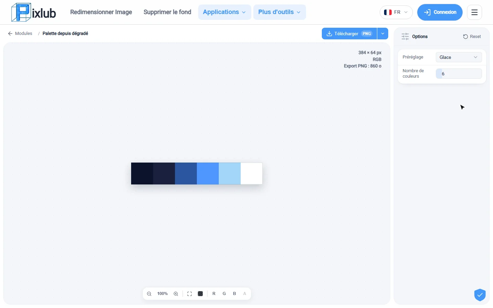

# Palette depuis dégradé

Découper un dégradé en un nombre fixe de couleurs.

**Catégorie** : Génération · **Identifiant** : `paletteFromGradient`

## Où l'utiliser

- **[Page du module](https://pixlub.com/fr/module/paletteFromGradient)** : Déposez vos fichiers, réglez, téléchargez : le module seul, sans rien d'autre.
- **[Graphe d'image](https://pixlub.com/fr/image/graph)** : Reliez-le à d'autres modules pour composer un effet plus complexe.

## Entrées

Ce module n’a pas d’entrée : il crée l’image à partir de ses seuls réglages.

## Présentation vidéo

▶ [Voir la vidéo](../../../../assets/modules/paletteFromGradient/demo.fr.mp4) : Dégradés tout prêts, puis nombre de couleurs.

1. `0:00` Le rendu s’affiche d’emblée
2. `0:01` Partir d’un dégradé tout prêt
3. `0:08` Nombre de couleurs
4. `0:12` Exporter le résultat

## Utilisation

1. **Choisir un dégradé**

   Un **préréglage** (crépuscule, feu, glace…) ou **Personnalisé** pour dessiner le vôtre.

2. **Choisir le nombre**

   Le dégradé est échantillonné à intervalles réguliers.

## Réglages

| Réglage | Effet |
| --- | --- |
| **Préréglage** | Personnalisé, Crépuscule, Feu, Glace, Forêt, Pastel, Niveaux de gris. |
| **Nombre de couleurs** | 2 à 32. |
| **Dégradé** | En Personnalisé : les points du dégradé. |

## Astuces

- Pratique pour une gamme de couleurs régulière (graphiques, cartes thermiques).

## Exportation

Le bouton **Télécharger** enregistre le résultat dans le format du fichier importé : une photo JPEG ressort en JPEG. Le menu à sa droite ouvre les **Paramètres d’export** pour choisir un autre format, régler la qualité, la taille ou le fond, et propose **Copier l’image**.

- **[La modale d’exportation](../../../../01-app/fr/02-image/04-exportation.md)** : Tous les formats, leurs réglages, le traitement local ou serveur, les lots et le dossier local.
