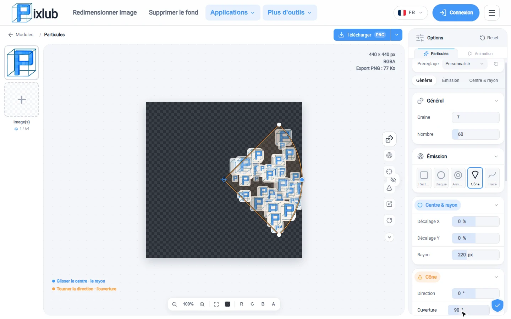
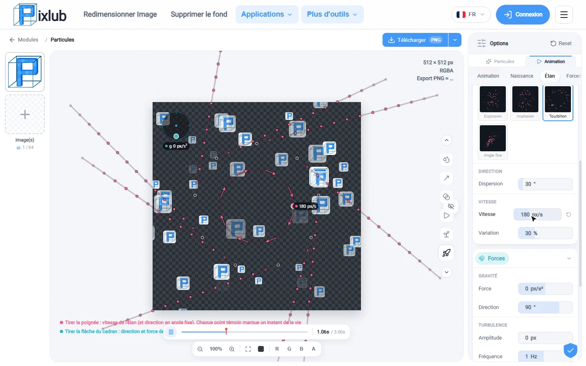

# Particules

Disperser une image en particules, fixes ou animées : forme d'émission, taille, traînées, mouvement.

**Catégorie** : Génération · **Identifiant** : `particles` · [Référence API](./api.md)

## Où l'utiliser

- **[Page du module](https://pixlub.com/fr/module/particles)** : Déposez vos fichiers, réglez, téléchargez : le module seul, sans rien d'autre.
- **[Graphe d'image](https://pixlub.com/fr/image/graph)** : Reliez-le à d'autres modules pour composer un effet plus complexe.

## Entrées

Les fichiers que la page du module accepte : déposez-les sur la zone d’import, ou cliquez dessus pour parcourir. Un fichier d’un autre format est écarté, avec un message qui rappelle les formats permis.

| Entrée | Formats acceptés | Fichiers |
| --- | --- | --- |
| **Image(s)** (obligatoire) Image dispersée en particules ; un batch mélange ses images entre les particules. | `PNG`, `JPEG`, `WebP`, `GIF`, `AVIF`, `BMP` | Jusqu’à 64 fichiers, réunis en un lot |

Par l’API, les fichiers et leurs formats sont détaillés dans la [vue API](./api.md).

## Présentation vidéo

▶ [Voir la vidéo](../../../../assets/modules/particles/demo.fr.mp4) : Particules fixes : nombre, forme d'émission, taille, rotation, traînée, préréglage.

1. `0:00` Importer l’image à disperser
2. `0:02` Nombre et graine
3. `0:07` Forme d’émission : cône
4. `0:12` Taille et rotation au hasard
5. `0:19` Traînée dans le sens du mouvement
6. `0:24` Ou un préréglage fixe
7. `0:31` Exporter le résultat

## Utilisation

1. **Importer**

   Déposez l'image à disperser. Un lot mélange ses images entre les particules.

2. **Disperser**

   **Nombre** et **graine**, puis la **forme d'émission** : rectangle, disque, anneau, cône ou tracé.

3. **Varier**

   Tailles, rotations et opacités mini / maxi : chaque particule tire sa valeur entre les deux.

Sans animation, le module rend une image fixe. Un **préréglage** (neige, bokeh, confettis…) règle tout d'un coup ; le filtre **Animés / Fixes** les trie.

## Réglages (onglet Particules)

| Réglage | Effet |
| --- | --- |
| **Graine** / **Nombre** | Tirage et quantité (1 à 3000). Une autre graine redistribue tout. |
| **Forme d'émission** | Rectangle, disque, anneau, cône ou tracé, avec centre, rayon, ouverture… |
| **Taille**, **Rotation**, **Opacité** | Bornes mini et maxi tirées au hasard. |
| **Direction & traînée** | Orienter selon la direction, longueur et atténuation de la traînée. |
| **Rendu** | Méthode de fusion d'une particule sur les autres. |

## Animer les particules

▶ [Voir la vidéo](../../../../assets/modules/particles/motion.fr.mp4) : Animation : naissance, élan, forces, fin de vie, lecture, préréglage animé, export GIF.

1. `0:00` Importer l’image à disperser
2. `0:05` Activer l’animation
3. `0:10` Naissance : en boucle, durée de vie
4. `0:14` Élan : tourbillon et vitesse
5. `0:21` Forces : gravité
6. `0:26` Au fil de la vie : extinction et taille
7. `0:34` Lire, arrêter, parcourir
8. `0:42` Ou un préréglage animé
9. `0:52` Exporter en GIF animé

1. **Activer l'animation**

   Onglet **Animation**, cochez **Animer les particules** : l'aperçu se met à jouer en boucle.

2. **Régler la naissance**

   **Boucle** (flux continu), **Une fois** (une salve après un délai) ou **Figée** (un seul instant). La **durée de vie** fixe le temps d'une particule.

3. **Lancer et pousser**

   **Élan** : explosion, implosion, tourbillon ou angle fixe, avec vitesse et dispersion. **Forces** : gravité, turbulence, frottement.

4. **Faire vivre et mourir**

   **Au fil de la vie** : apparition, extinction, taille en fin de vie, rotation.

5. **Exporter**

   Sous l'aperçu, la mini-timeline lit, arrête et parcourt l'animation. Dans **Paramètres d'export**, onglet **Animé** : **GIF animé** ou **APNG**.

| Réglage | Effet |
| --- | --- |
| **Naissance** | Boucle, une fois (avec **délai**) ou figée (avec **phase**). |
| **Durée de vie** | 0 à 20 s par particule. La boucle dure un nombre entier de vies : elle se raccorde sans saut. |
| **Élan** | Direction (explosion, implosion, tourbillon, angle fixe), dispersion, vitesse et sa variation. |
| **Forces** | Gravité (force et direction), turbulence (amplitude, fréquence), frottement. |
| **Au fil de la vie** | Apparition et extinction (part de la vie), taille finale, vitesse de rotation. |
| **Piloter par phase** | L'animation ne suit plus le temps toute seule : sa **phase** (0 à 100 %) se pose en clés. |

Dans l'aperçu, la poignée rose règle la vitesse de l'élan, le cadran en haut à gauche la direction et la force de la gravité ; les points témoins marquent la trajectoire à intervalles réguliers.

### Dans le graphe d'image

Un module Particules animé joue tout seul dans le [graphe d'image](../../../../01-app/fr/02-image/01-image-graph.md#animation) : le bandeau de temps s'ouvre et la boucle prend la durée de l'animation. Pour la caler sur d'autres éléments, cochez **Piloter par phase** et posez des clés sur **Phase** dans la timeline (0 % : début, 100 % : fin). L'export se fait par le module **Export**, en APNG par défaut.

## Astuces

- Pour une boucle sans à-coup, gardez la durée de l'animation multiple de la **durée de vie**.
- **Figée** + **Phase** donne une image fixe d'un instant précis de l'animation (une explosion à mi-course, par exemple).
- Un GIF ne garde que 256 couleurs : pour des particules douces ou transparentes, préférez l'APNG.

## Exportation

Le bouton **Télécharger** enregistre le résultat dans le format du fichier importé : une photo JPEG ressort en JPEG. Le menu à sa droite ouvre les **Paramètres d’export** pour choisir un autre format, régler la qualité, la taille ou le fond, et propose **Copier l’image**.

Avec plusieurs images, le bouton devient **Téléchargement ZIP** ; le menu propose aussi les fichiers séparés, ou la seule image affichée.

- **[La modale d’exportation](../../../../01-app/fr/02-image/04-exportation.md)** : Tous les formats, leurs réglages, le traitement local ou serveur, les lots et le dossier local.
