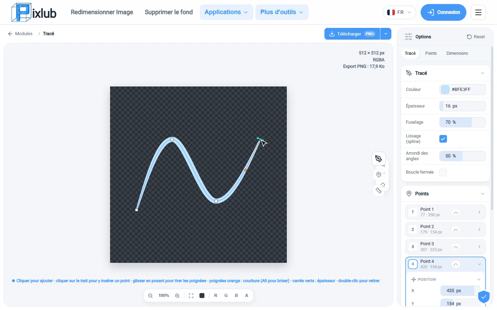

# Tracé

Dessiner des tracés vectoriels : plume, crayon, formes, traits fuselés et remplissages.

**Catégorie** : Génération · **Identifiant** : `pathStroke`

## Où l'utiliser

- **[Page du module](https://pixlub.com/fr/module/pathStroke)** : Déposez vos fichiers, réglez, téléchargez : le module seul, sans rien d'autre.
- **[Graphe d'image](https://pixlub.com/fr/image/graph)** : Reliez-le à d'autres modules pour composer un effet plus complexe.

## Entrées

Ce module n’a pas d’entrée : il crée l’image à partir de ses seuls réglages.

## Présentation vidéo

▶ [Voir la vidéo](../../../../assets/modules/pathStroke/demo.fr.mp4) : Dessiner le tracé, épaisseur et fuselage, couleur.

1. `0:00` Le rendu s’affiche d’emblée
2. `0:01` Dessiner le tracé
3. `0:07` Épaisseur et fuselage
4. `0:13` Couleur
5. `0:18` Exporter le résultat

## Utilisation

1. **Choisir un mode**

   La barre en tête de l'aperçu propose deux modes. **Base** donne les outils vectoriels habituels. **Arrondi** pose des points reliés par des arcs, pour les boucles et les cercles.

2. **Dessiner**

   En mode Base, prenez la **plume** (un clic pose un point vif, un glissement tire une courbe), le **crayon** (un trait à main levée devient un tracé lissé) ou une **forme** : segment, rectangle, ellipse, polygone, étoile. Chaque dessin ajoute un tracé à la liste.

3. **Retoucher**

   La **sélection** déplace, redimensionne et tourne les tracés entiers. La **sélection directe** déplace les points, leurs poignées de courbure et leur épaisseur locale. Les **ciseaux** coupent un tracé.

4. **Régler l'aspect**

   Les **calques**, en bas à gauche de l'aperçu, rangent les tracés et se déplient sur leurs points. Le panneau de droite montre la fiche du tracé choisi : trait, remplissage, fuselage, tirets, opacité.

## Outils du mode Base

| Outil | Touche | Gestes |
| --- | --- | --- |
| **Sélection** | V | Cliquer un tracé (**Maj** : plusieurs), le glisser (**Alt** : copier), tirer les poignées de la boîte, tourner autour d'elle. Double-clic : éditer ses points. |
| **Sélection directe** | A | Glisser un point ou ses poignées orange (**Alt** : briser, **Ctrl** : symétriques). **Alt** + glisser un point : tirer des poignées neuves. Carrés verts : épaisseur locale. Double-clic : point vif ou arrondi. |
| **Plume** | P | Cliquer : point vif. Glisser : courbe. Clic sur le premier point : fermer. Clic sur un bout : prolonger. Clic sur le trait choisi : insérer un point. Clic sur un point : le retirer (**Alt** : vif ou arrondi). **Entrée** ou double-clic : finir. |
| **Crayon** | N | Dessiner à main levée. Partir du bout d'un tracé choisi le prolonge ; revenir au départ le ferme. |
| **Segment**, **Rectangle**, **Ellipse** | L, M, E | Glisser. **Maj** : angle par pas de 15°, carré ou cercle. **Alt** : depuis le centre. |
| **Polygone**, **Étoile** | Y, S | Glisser depuis le centre : taille et orientation. |
| **Ciseaux** | C | Cliquer sur un tracé ou sur un point : le couper à cet endroit. |

**Suppr** retire les points ou les tracés choisis, les flèches les décalent d'un pixel (**Maj** : dix), **Ctrl+D** duplique, **Ctrl+J** joint deux tracés ou ferme un tracé seul.

À gauche de l'aperçu, les actions alignent et répartissent les tracés choisis, changent leur ordre, les inversent, les simplifient, ou en font une **découpe** : le tracé efface alors ce qui est peint sous lui au lieu de s'y ajouter.

Avec plusieurs tracés choisis, **Combiner les formes** les réunit en une seule : **Unir**, **Soustraire le dessus**, **Intersecter**, **Exclure le recouvrement**. Le résultat prend l'aspect du tracé du fond ; un trou devient un tracé de découpe.

## Calques

Le panneau **Calques** liste les tracés, le dessus en premier. Glissez une ligne pour changer l'ordre, cliquez l'œil pour masquer, le cadenas pour verrouiller, double-cliquez le nom pour le changer. La flèche déplie un tracé sur ses points : un clic sur un point le choisit et prend la sélection directe. Dans l'éditeur d'image, ces mêmes lignes se déplient sous le calque de tracés ; dans la fenêtre « Dessiner le tracé », elles sortent d'un tiroir.

## Mode Arrondi

Cliquez pour poser des points : chacun s'arrondit en arc avec ses voisins. Les points s'aimantent aux autres points et au centre, **Maj** les guide par pas de 15°. **Alt** + clic sur un point le rend vif, ou de nouveau arrondi. **Cercle parfait** replace les points sur un cercle, **Répartir les points** régularise une forme déjà dessinée. Le mode travaille sur le tracé choisi dans la liste ; **Nouveau tracé** en commence un autre.

## Réglages

| Réglage | Effet |
| --- | --- |
| **Tracés** | La fiche du tracé choisi dans les calques. |
| **Trait** | Couleur, épaisseur, fuselage des extrémités, forme des bouts et des angles, tirets. |
| **Remplissage** | Couleur de l'intérieur du tracé, et opacité du tracé entier. |
| **Forme** | Nom, fermeture, arrondi des points arrondis (50 % = arcs de cercle exacts), découpe, verrou, portion montrée. |
| **Point** | Position, épaisseur locale et type du point choisi ; dans le graphe, X, Y et l'épaisseur de chaque point s'animent. |
| **Portion** | Début et fin du trait visible de tous les tracés, en % de leur longueur : animée de 0 à 100 %, le dessin se trace. |
| **Dimensions** | Taille de la zone. |

## Astuces

- La sortie **Chemin** rend le premier tracé visible de la pile : c'est lui que suivent les modules Suivre un chemin, Déformation le long d'un chemin et Particules.
- Un tracé dessiné avant l'arrivée des outils vectoriels s'ouvre tel quel, comme un document d'un seul tracé.

## Exportation

Le bouton **Télécharger** enregistre le résultat dans le format du fichier importé : une photo JPEG ressort en JPEG. Le menu à sa droite ouvre les **Paramètres d’export** pour choisir un autre format, régler la qualité, la taille ou le fond, et propose **Copier l’image**.

- **[La modale d’exportation](../../../../01-app/fr/02-image/04-exportation.md)** : Tous les formats, leurs réglages, le traitement local ou serveur, les lots et le dossier local.
