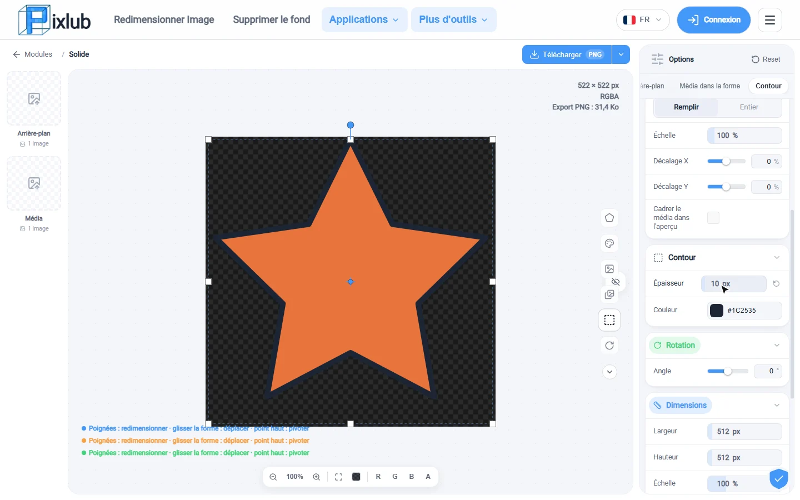

# Solide

Générer une forme pleine : couleur, dégradé ou image à l'intérieur.

**Catégorie** : Génération · **Identifiant** : `solid` · [Référence API](./api.md)

## Où l'utiliser

- **[Page du module](https://pixlub.com/fr/module/solid)** : Déposez vos fichiers, réglez, téléchargez : le module seul, sans rien d'autre.
- **[Graphe d'image](https://pixlub.com/fr/image/graph)** : Reliez-le à d'autres modules pour composer un effet plus complexe.

## Entrées

Les fichiers que la page du module accepte : déposez-les sur la zone d’import, ou cliquez dessus pour parcourir. Un fichier d’un autre format est écarté, avec un message qui rappelle les formats permis.

| Entrée | Formats acceptés | Fichiers |
| --- | --- | --- |
| **Arrière-plan** (facultative) Image facultative placée sous la forme ; reliée, elle fixe aussi la taille du résultat. | `PNG`, `JPEG`, `WebP`, `GIF`, `AVIF`, `BMP` | Un fichier |
| **Média** (facultative) Image facultative vue à travers la forme, à la place de sa couleur ; le contour reste par-dessus. | `PNG`, `JPEG`, `WebP`, `GIF`, `AVIF`, `BMP` | Un fichier |

Par l’API, les fichiers et leurs formats sont détaillés dans la [vue API](./api.md).

## Présentation vidéo

▶ [Voir la vidéo](../../../../assets/modules/solid/demo.fr.mp4) : Forme, couleur, contour, déplacement, puis une image dans la forme.

1. `0:00` Le rendu s’affiche d’emblée
2. `0:01` Choisir la forme
3. `0:05` Couleur
4. `0:10` Ajouter un contour
5. `0:13` Déplacer et pivoter à la souris
6. `0:16` Une image dans la forme
7. `0:19` Exporter le résultat

## Utilisation

1. **Choisir la forme**

   Rectangle, cercle, ellipse, anneau, triangle, losange, polygone ou étoile.

2. **Colorer**

   Couleur unie ou dégradé, contour en option.

3. **Placer**

   Dans l'aperçu : glissez pour déplacer, tirez les poignées, le point haut pour pivoter.

## Réglages

| Réglage | Effet |
| --- | --- |
| **Forme** | Avec ses réglages propres : arrondi, épaisseur d'anneau, côtés, branches. |
| **Couleur** / **Remplissage intérieur** | Couleur ou dégradé ; fondu depuis le centre. |
| **Arrière-plan** | Image facultative sous la forme ; elle fixe la taille du résultat. |
| **Média dans la forme** | Image vue à travers la forme : remplir ou entière, échelle, décalage. |
| **Contour** | Épaisseur et couleur. |
| **Dimensions**, **Position**, **Rotation** | Taille de la zone et place de la forme. |

## Astuces

- Une photo dans un cercle donne un avatar en un geste.
- Un double-clic sur la forme passe au cadrage du média dans l'aperçu.

## Exportation

Le bouton **Télécharger** enregistre le résultat dans le format du fichier importé : une photo JPEG ressort en JPEG. Le menu à sa droite ouvre les **Paramètres d’export** pour choisir un autre format, régler la qualité, la taille ou le fond, et propose **Copier l’image**.

- **[La modale d’exportation](../../../../01-app/fr/02-image/04-exportation.md)** : Tous les formats, leurs réglages, le traitement local ou serveur, les lots et le dossier local.
