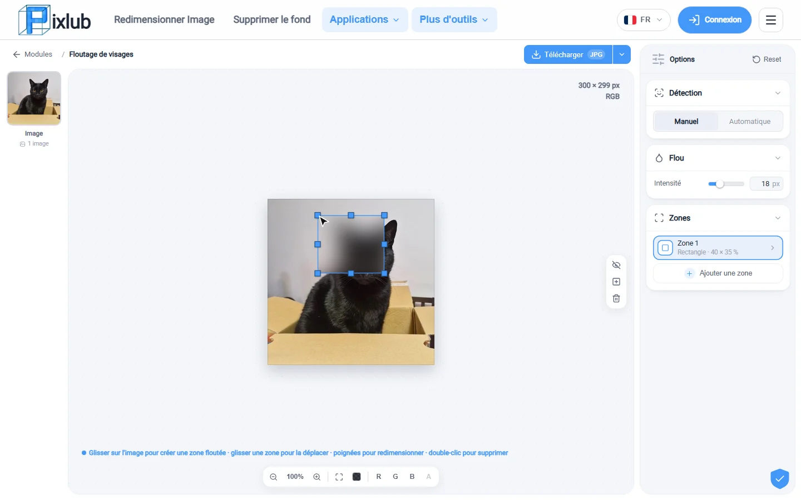

# Floutage de visages

Flouter des zones tracées à la main, ou les visages détectés par IA.

**Catégorie** : Services API · **Identifiant** : `faceBlurApi` · [Référence API](./api.md)

## Où l'utiliser

- **[Page du module](https://pixlub.com/fr/module/faceBlurApi)** : Déposez vos fichiers, réglez, téléchargez : le module seul, sans rien d'autre.
- **[Graphe d'image](https://pixlub.com/fr/image/graph)** : Reliez-le à d'autres modules pour composer un effet plus complexe.

## Entrées

Les fichiers que la page du module accepte : déposez-les sur la zone d’import, ou cliquez dessus pour parcourir. Un fichier d’un autre format est écarté, avec un message qui rappelle les formats permis.

| Entrée | Formats acceptés | Fichiers |
| --- | --- | --- |
| **Image** (obligatoire) Image dont les zones sont floutées. En mode automatique, elle est envoyée au serveur pour y détecter les visages. | `PNG`, `JPEG`, `WebP` | Un fichier |

Par l’API, les fichiers et leurs formats sont détaillés dans la [vue API](./api.md).

## Présentation vidéo

▶ [Voir la vidéo](../../../../assets/modules/faceBlurApi/demo.fr.mp4) : Tracer une zone, la déplacer, régler l'intensité.

1. `0:00` Importer une photo
2. `0:03` Tracer une zone à flouter
3. `0:06` Déplacer la zone
4. `0:09` Intensité du flou
5. `0:13` Exporter le résultat

## Utilisation

1. **Importer**

   Déposez une photo.

2. **Mode manuel**

   Glissez sur l'aperçu pour tracer une zone ; glissez-la pour la déplacer, tirez ses poignées, double-cliquez pour la supprimer.

3. **Ou mode automatique**

   Les visages sont détectés par nos serveurs (compte et crédits) ; les zones restent modifiables ensuite.

## Réglages

| Réglage | Effet |
| --- | --- |
| **Mode** | **Manuel** (local, gratuit) ou **Automatique** (détection par IA). |
| **Intensité** | 1 à 60 px de flou. |
| **Zones** | La liste des zones floutées. |

## Astuces

- En mode manuel, rien ne quitte votre navigateur : la pastille reste sur « Traitement local ».

## Exportation

Le bouton **Télécharger** enregistre le résultat dans le format du fichier importé : une photo JPEG ressort en JPEG. Le menu à sa droite ouvre les **Paramètres d’export** pour choisir un autre format, régler la qualité, la taille ou le fond, et propose **Copier l’image**.

- **[La modale d’exportation](../../../../01-app/fr/02-image/04-exportation.md)** : Tous les formats, leurs réglages, le traitement local ou serveur, les lots et le dossier local.
