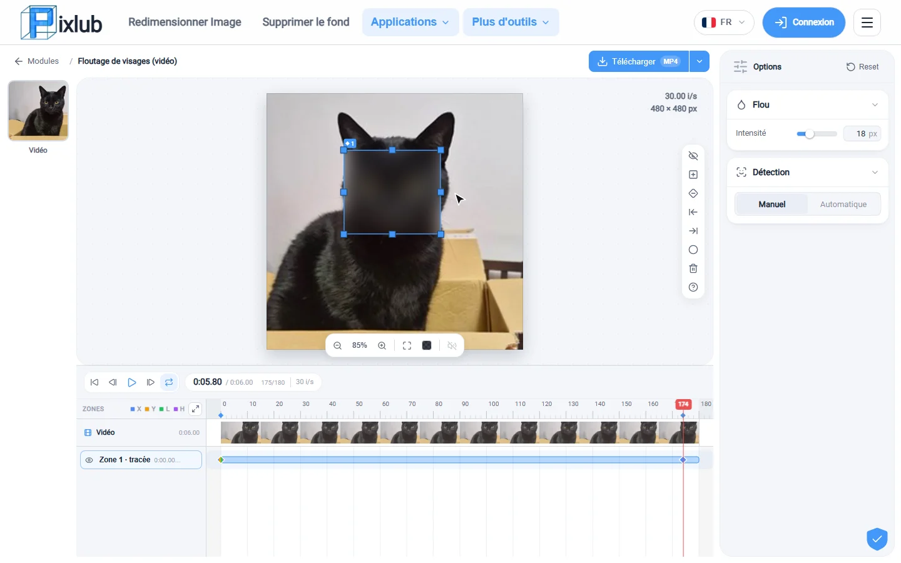

# Floutage de visages (vidéo)

Flouter des zones tracées à la main, ou les visages détectés sur chaque image d'une vidéo.

**Catégorie** : Services API · **Identifiant** : `faceBlurVideoApi`

## Où l'utiliser

- **[Page du module](https://pixlub.com/fr/module/faceBlurVideoApi)** : Déposez vos fichiers, réglez, téléchargez : le module seul, sans rien d'autre.
- **[Éditeur vidéo](https://pixlub.com/fr/video/editor)** : Posez-le en effet sur un plan du montage.

## Entrées

Les fichiers que la page du module accepte : déposez-les sur la zone d’import, ou cliquez dessus pour parcourir. Un fichier d’un autre format est écarté, avec un message qui rappelle les formats permis.

| Entrée | Formats acceptés | Fichiers |
| --- | --- | --- |
| **Vidéo** (obligatoire) Vidéo floutée dans le navigateur. En mode automatique, elle est envoyée une fois au serveur pour y détecter les visages. | `MP4`, `WebM`, `MOV`, `MKV` | Un fichier |

## Présentation vidéo

▶ [Voir la vidéo](../../../../assets/modules/faceBlurVideoApi/demo.fr.mp4) : Tracer une zone sur le visage, la recaler plus loin, lire le résultat.

1. `0:00` Importer une vidéo
2. `0:03` Tracer une zone sur le visage
3. `0:06` Plus loin, la recaler : une clé est posée
4. `0:11` Les clés dans la timeline
5. `0:16` Lire : le flou suit le visage
6. `0:25` Intensité du flou
7. `0:29` Exporter le résultat

## Utilisation

1. **Importer**

   Déposez une vidéo : en mode **Manuel**, elle ne quitte pas votre machine.

2. **Tracer une zone**

   Glissez sur l'aperçu pour couvrir un visage ; la zone vaut pour toute la vidéo.

3. **La faire suivre**

   Plus loin dans la vidéo, glissez la zone sur le visage : une clé est posée et les images entre deux clés suivent.

4. **Ou mode automatique**

   Nos serveurs détectent les visages de chaque image (compte et crédits) ; les zones restent modifiables ensuite.

## Réglages

| Réglage | Effet |
| --- | --- |
| **Mode** | **Manuel** (zones tracées, tout reste local) ou **Automatique** (détection par nos serveurs). |
| **Intensité** | 1 à 60 px de flou. |
| **Hauteur de travail** | Automatique : de 360 à 1080 px ; plus basse, la détection est plus rapide. |
| **Marge autour du visage** | Automatique : élargit chaque zone détectée pour suivre les mouvements. |
| **Persistance** | Automatique : 0 à 30 images pendant lesquelles une zone reste quand le visage n'est plus trouvé. |

## Astuces

- Dans la timeline, chaque clé est colorée selon ce qu'elle fixe (X, Y, largeur, hauteur) : survolez-la pour ses valeurs, cliquez pour les saisir, **Suppr** la retire et <kbd>Ctrl</kbd> + <kbd>Z</kbd> annule.
- En mode automatique, montez la **persistance** si un flou clignote quand une personne tourne la tête.

## Exportation

Le résultat s’exporte depuis la page du module ou l’éditeur vidéo, en MP4, WebM ou un autre conteneur vidéo, sans quitter votre navigateur.

- **[L’éditeur vidéo](../../../../01-app/fr/03-video/01-video-editor.md)** : Monter, régler les effets et exporter une vidéo.
