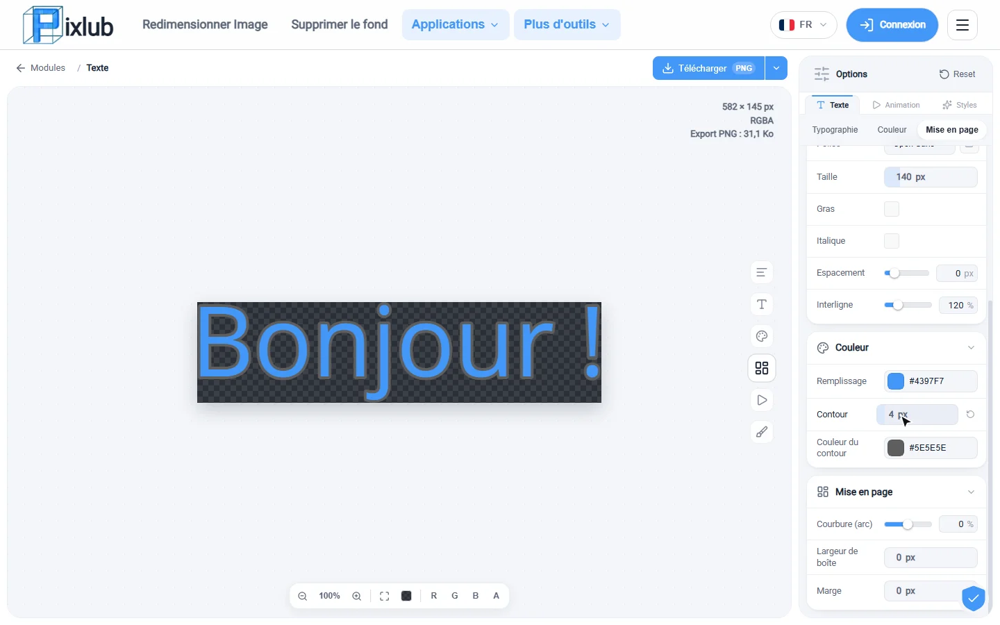

# Texte

Composer un texte : police, couleur ou dégradé, styles et animation.

**Catégorie** : Texte · **Identifiant** : `text`

## Où l'utiliser

- **[Page du module](https://pixlub.com/fr/module/text)** : Déposez vos fichiers, réglez, téléchargez : le module seul, sans rien d'autre.
- **[Graphe d'image](https://pixlub.com/fr/image/graph)** : Reliez-le à d'autres modules pour composer un effet plus complexe.

## Entrées

Ce module n’a pas d’entrée : il crée l’image à partir de ses seuls réglages.

## Présentation vidéo

▶ [Voir la vidéo](../../../../assets/modules/text/demo.fr.mp4) : Écrire, taille, couleur, contour, courbure.

1. `0:00` Le texte s’affiche d’emblée
2. `0:01` Écrire le texte
3. `0:04` Taille, couleur et contour
4. `0:14` Courber le texte
5. `0:19` Exporter le résultat

## Utilisation

1. **Écrire**

   Tapez le texte dans **Contenu** ; les retours à la ligne se saisissent directement.

2. **Mettre en forme**

   Police, taille, gras, espacement, couleur ou dégradé, contour, courbure.

3. **Animer ou styliser**

   L'onglet **Animation** fait apparaître le texte, l'onglet **Styles** empile des effets sur le texte.

## Réglages

| Réglage | Effet |
| --- | --- |
| **Contenu** | Texte, alignement et casse. |
| **Typographie** | Police (ou la vôtre, importée), taille, gras, italique, espacement, interligne. |
| **Couleur** | Remplissage uni ou dégradé, contour. |
| **Mise en page** | Courbure en arc, largeur de boîte (retour à la ligne), marge. |
| **Animation** | Une entrée animée (fondu, rebond, machine à écrire…), avec durée et retard. |
| **Styles** | Une pile d'effets posés sur le texte. |

## Astuces

- Exportez en PNG pour un texte détouré, en GIF ou APNG pour une animation.
- Le **préréglage** en haut du panneau donne un style complet d'un clic.

## Exportation

Le bouton **Télécharger** enregistre le résultat dans le format du fichier importé : une photo JPEG ressort en JPEG. Le menu à sa droite ouvre les **Paramètres d’export** pour choisir un autre format, régler la qualité, la taille ou le fond, et propose **Copier l’image**.

- **[La modale d’exportation](../../../../01-app/fr/02-image/04-exportation.md)** : Tous les formats, leurs réglages, le traitement local ou serveur, les lots et le dossier local.
