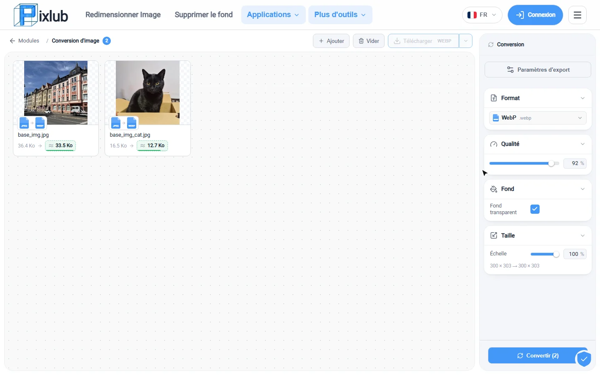

# Conversion

Convertir images, vidéos et sons dans n'importe quel format de l'export, avec le poids estimé.

**Catégorie** : Conversion · **Identifiant** : `convert` · [Référence API](./api.md)

## Où l'utiliser

- **[Page du module](https://pixlub.com/fr/module/convert)** : Déposez vos fichiers, réglez, téléchargez : le module seul, sans rien d'autre.

## Entrées

Les fichiers que la page du module accepte : déposez-les sur la zone d’import, ou cliquez dessus pour parcourir. Un fichier d’un autre format est écarté, avec un message qui rappelle les formats permis.

| Entrée | Formats acceptés | Fichiers |
| --- | --- | --- |
| **Image(s)** (obligatoire) Image(s) à convertir dans le format choisi. | `PNG`, `JPEG`, `WebP`, `GIF`, `AVIF`, `BMP` | Un ou plusieurs : chaque image est traitée à part, avec les mêmes réglages |

Le nombre d’images traitées d’un coup dépend de votre offre.

Par l’API, les fichiers et leurs formats sont détaillés dans la [vue API](./api.md).

## Présentation vidéo

▶ [Voir la vidéo](../../../../assets/modules/convert/demo.fr.mp4) : Importer, choisir le format, l'échelle, puis convertir.

1. `0:00` Importer des images
2. `0:03` Choisir le format
3. `0:07` Échelle et poids estimé
4. `0:11` Convertir

## Utilisation

1. **Importer**

   Déposez vos images ; chaque carte montre le format d'origine, le nouveau et le poids estimé.

2. **Choisir le format**

   Le menu **Format** propose tout le catalogue d'export ; **Paramètres d'export** ouvre ses réglages.

3. **Convertir**

   **Convertir** lance le lot.

## Réglages

| Réglage | Effet |
| --- | --- |
| **Format** | PNG, JPEG, WebP, AVIF… Les formats calculés sur nos serveurs sont signalés. |
| **Fond transparent** | Gardé si le format le permet, sinon remplacé par une couleur. |
| **Échelle** | Réduit les images au moment de la conversion. |

## Astuces

- Le poids estimé aide à choisir entre qualité et légèreté avant de convertir.
- Pour chaque format, voir la [modale d'exportation](../../../../01-app/fr/02-image/04-exportation.md).

## Exportation

Le bouton **Télécharger** enregistre le résultat dans le format du fichier importé : une photo JPEG ressort en JPEG. Le menu à sa droite ouvre les **Paramètres d’export** pour choisir un autre format, régler la qualité, la taille ou le fond, et propose **Copier l’image**.

Ce module fixe lui-même le format du fichier rendu, selon ses réglages : PNG, JPEG, WebP.

Avec plusieurs images, le bouton devient **Téléchargement ZIP** ; le menu propose aussi les fichiers séparés, ou la seule image affichée.

- **[La modale d’exportation](../../../../01-app/fr/02-image/04-exportation.md)** : Tous les formats, leurs réglages, le traitement local ou serveur, les lots et le dossier local.
