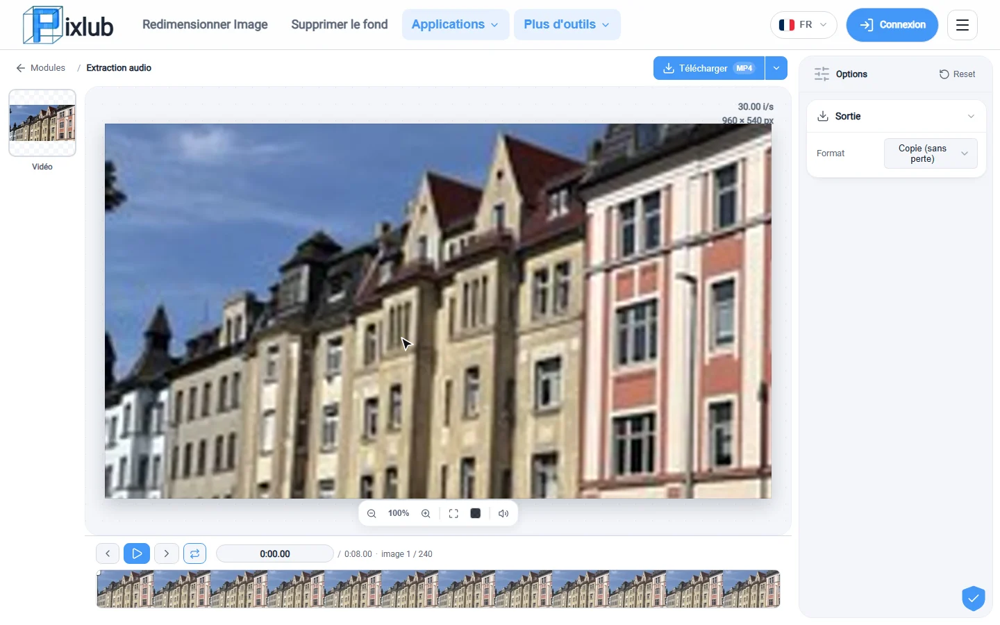

# Extraction audio

Sortir la piste son d'une vidéo dans un fichier audio.

**Catégorie** : Conversion · **Identifiant** : `extractAudioVideo`

## Où l'utiliser

- **[Page du module](https://pixlub.com/fr/module/extractAudioVideo)** : Déposez vos fichiers, réglez, téléchargez : le module seul, sans rien d'autre.
- **[Éditeur vidéo](https://pixlub.com/fr/video/editor)** : Posez-le en effet sur un plan du montage.

## Entrées

Les fichiers que la page du module accepte : déposez-les sur la zone d’import, ou cliquez dessus pour parcourir. Un fichier d’un autre format est écarté, avec un message qui rappelle les formats permis.

| Entrée | Formats acceptés | Fichiers |
| --- | --- | --- |
| **Vidéo** (obligatoire) Vidéo dont la piste sonore est extraite. | `MP4`, `WebM`, `MOV`, `MKV` | Un fichier |

## Présentation vidéo

▶ [Voir la vidéo](../../../../assets/modules/extractAudioVideo/demo.fr.mp4) : Importer une vidéo, choisir le format audio.

1. `0:00` Importer une vidéo
2. `0:05` Choisir le format audio
3. `0:09` Exporter le résultat

## Utilisation

1. **Importer**

   Déposez une ou plusieurs vidéos avec du son : chacune a son espace de travail.

2. **Garder une partie**

   Tirez les poignées de la timeline, où la forme d'onde suit les images.

3. **Choisir le format**

   Dans la fenêtre d'export : piste d'origine, MP3, AAC, Opus, Vorbis, FLAC, WAV ou AIFF.

## Réglages

| Réglage | Effet |
| --- | --- |
| **Début / Fin** | Partie du son gardée, en secondes (0 en fin = jusqu'au bout). |
| **Format** (export) | Piste d'origine (sans perte), MP3, AAC, Opus, Vorbis, FLAC, WAV ou AIFF. |
| **Débit, fréquence, canaux, profondeur** (export) | Selon le format choisi. |

## Astuces

- La **piste d'origine** est instantanée et sans perte : préférez-la si son format vous convient.
- FLAC garde tout le son, en deux fois plus léger que le WAV.

## Exportation

Le résultat s’exporte depuis la page du module ou l’éditeur vidéo, en MP4, WebM ou un autre conteneur vidéo, sans quitter votre navigateur.

- **[L’éditeur vidéo](../../../../01-app/fr/03-video/01-video-editor.md)** : Monter, régler les effets et exporter une vidéo.
