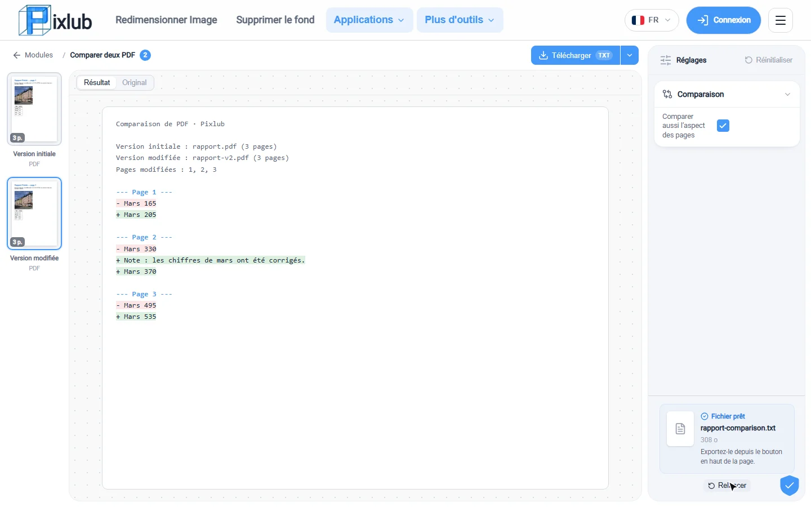

# Comparer deux PDF

Lister les lignes ajoutées et retirées page par page entre deux versions d'un PDF.

**Catégorie** : Documents · **Identifiant** : `docCompare`

## Où l'utiliser

- **[Page du module](https://pixlub.com/fr/module/docCompare)** : Déposez vos fichiers, réglez, téléchargez : le module seul, sans rien d'autre.

## Présentation vidéo

▶ [Voir la vidéo](../../../../assets/modules/docCompare/demo.fr.mp4) : Deux versions, comparaison, rapport.

1. `0:00` Importer les deux versions
2. `0:07` Comparer
3. `0:13` Télécharger le résultat

## Utilisation

1. **Importer**

   La **version initiale** dans la première case, la **version modifiée** dans la seconde.

2. **Lancer**

   Le rapport liste, page par page, les lignes retirées (−) et ajoutées (+).

## Réglages

| Réglage | Effet |
| --- | --- |
| **Comparer aussi l'aspect des pages** | Signale les pages au texte identique mais à la mise en page différente. Plus lent. |

## Astuces

- Le rapport se télécharge en texte, à joindre à une relecture.
