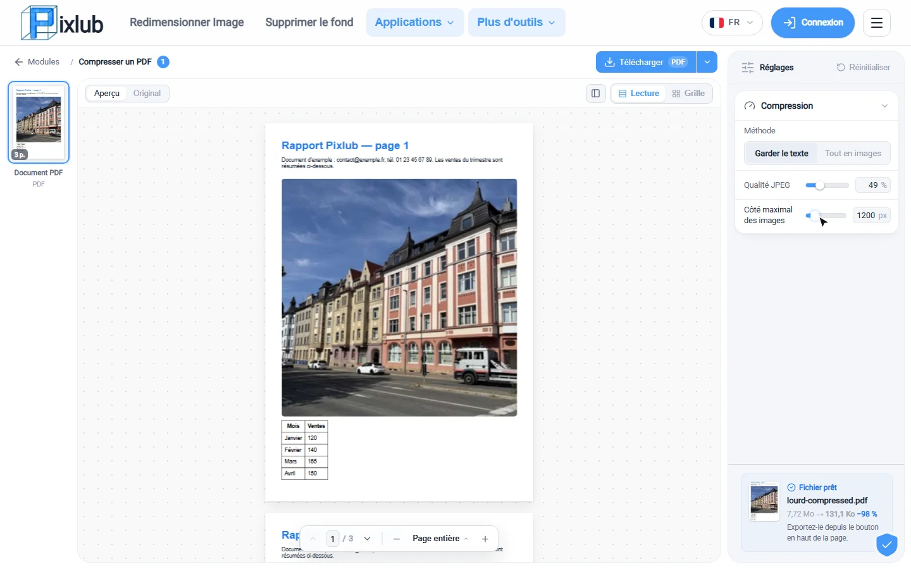

# Compresser un PDF

Réduire le poids d'un PDF en réencodant ses images ; le texte reste net.

**Catégorie** : Documents · **Identifiant** : `docCompress`

## Où l'utiliser

- **[Page du module](https://pixlub.com/fr/module/docCompress)** : Déposez vos fichiers, réglez, téléchargez : le module seul, sans rien d'autre.

## Présentation vidéo

▶ [Voir la vidéo](../../../../assets/modules/docCompress/demo.fr.mp4) : Qualité et taille des images, puis tout en images.

1. `0:00` Importer un PDF lourd
2. `0:03` Qualité et taille des images
3. `0:13` Tout en images
4. `0:18` Télécharger le résultat

## Utilisation

1. **Importer**

   Déposez un PDF ; son poids s'affiche.

2. **Régler**

   **Qualité JPEG** et **côté maximal** des images.

3. **Lancer**

   Le nouveau poids s'affiche avant le téléchargement.

## Réglages

| Réglage | Effet |
| --- | --- |
| **Méthode** | **Garder le texte** (images réencodées) ou **Tout en images** (chaque page en JPEG). |
| **Qualité JPEG** | 30 à 95 %. |
| **Côté maximal des images** | 300 à 6000 px. |
| **Résolution des pages** | Tout en images : 72 à 300 ppp. |

## Astuces

- **Tout en images** compresse le plus un scan, mais le texte n'est plus sélectionnable.
