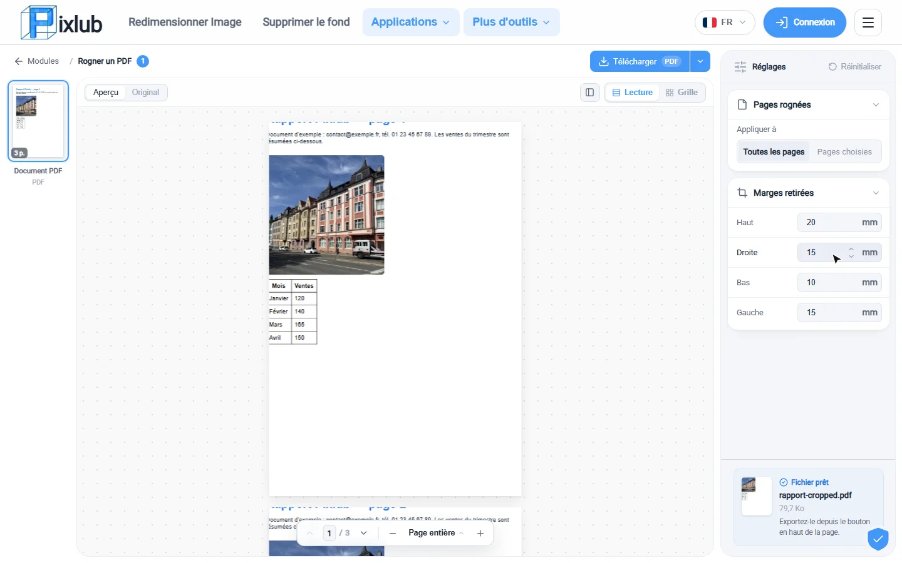

# Rogner un PDF

Retirer une marge autour des pages, sans toucher à leur contenu.

**Catégorie** : Documents · **Identifiant** : `docCrop`

## Où l'utiliser

- **[Page du module](https://pixlub.com/fr/module/docCrop)** : Déposez vos fichiers, réglez, téléchargez : le module seul, sans rien d'autre.

## Présentation vidéo

▶ [Voir la vidéo](../../../../assets/modules/docCrop/demo.fr.mp4) : Marges retirées, puis rognage page par page.

1. `0:00` Importer un PDF
2. `0:03` Marges retirées
3. `0:14` Ou page par page
4. `0:17` Télécharger le résultat

## Utilisation

1. **Importer**

   Déposez un PDF.

2. **Régler les marges**

   Haut, droite, bas, gauche, en millimètres.

3. **Ou page par page**

   **Pages choisies** donne des marges propres à chaque groupe de pages.

## Réglages

| Réglage | Effet |
| --- | --- |
| **Appliquer à** | Toutes les pages, ou des pages choisies. |
| **Haut** / **Droite** / **Bas** / **Gauche** | 0 à 500 mm. |
| **Rognages** | Mode Pages choisies : une ligne par groupe de pages. |

## Astuces

- Le contenu rogné n'est que masqué : pour supprimer vraiment du texte, utilisez [Caviarder](../docRedact/README.md).
