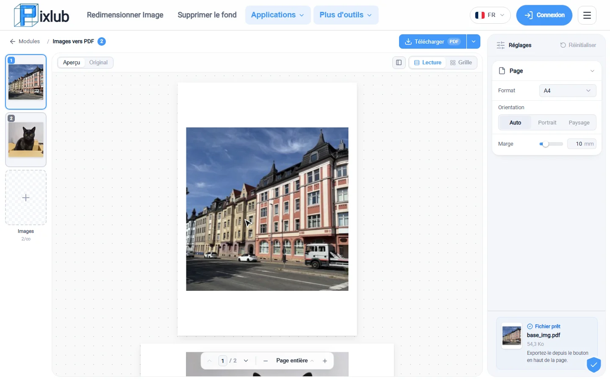

# Images vers PDF

Assembler des images en un PDF, une image par page.

**Catégorie** : Documents · **Identifiant** : `docImagesToPdf`

## Où l'utiliser

- **[Page du module](https://pixlub.com/fr/module/docImagesToPdf)** : Déposez vos fichiers, réglez, téléchargez : le module seul, sans rien d'autre.

## Présentation vidéo

▶ [Voir la vidéo](../../../../assets/modules/docImagesToPdf/demo.fr.mp4) : Importer des images, format de page, marge.

1. `0:00` Importer des images
2. `0:03` Format de page
3. `0:09` Marge
4. `0:15` Télécharger le résultat

## Utilisation

1. **Importer**

   Déposez vos images (PNG, JPEG, WebP) ; réordonnez-les dans la liste.

2. **Choisir la page**

   Format A4, A3, A5, Lettre US… ou la taille de chaque image.

3. **Lancer**

   Un PDF, une image par page.

## Réglages

| Réglage | Effet |
| --- | --- |
| **Format** | Taille de l'image, A4, A3, A5, Lettre US ou Légal US. |
| **Orientation** | Automatique, portrait ou paysage. |
| **Marge** | 0 à 50 mm autour de chaque image. |

## Astuces

- Orientation automatique : chaque page suit le sens de son image.
