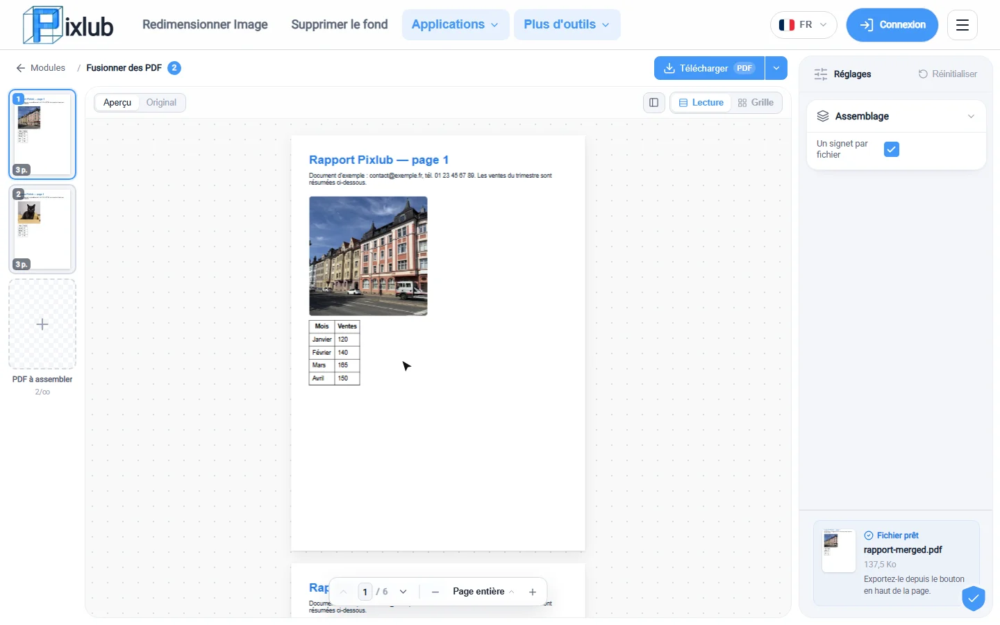

# Fusionner des PDF

Assembler plusieurs PDF en un seul fichier, dans l'ordre choisi.

**Catégorie** : Documents · **Identifiant** : `docMerge`

## Où l'utiliser

- **[Page du module](https://pixlub.com/fr/module/docMerge)** : Déposez vos fichiers, réglez, téléchargez : le module seul, sans rien d'autre.

## Présentation vidéo

▶ [Voir la vidéo](../../../../assets/modules/docMerge/demo.fr.mp4) : Importer plusieurs PDF, signets, grille des pages.

1. `0:00` Importer plusieurs PDF
2. `0:03` Un signet par fichier
3. `0:13` Télécharger le résultat

## Utilisation

1. **Importer**

   Déposez au moins deux PDF ; réordonnez-les dans la liste.

2. **Vérifier**

   La vue **Grille** montre toutes les pages à la suite.

3. **Télécharger**

   Un seul PDF, dans l'ordre de la liste.

## Réglages

| Réglage | Effet |
| --- | --- |
| **Un signet par fichier** | Ajoute un signet au début de chaque document, nommé d'après son fichier. |

## Astuces

- Pour garder seulement certaines pages ensuite, passez par [Organiser les pages](../docPages/README.md).
