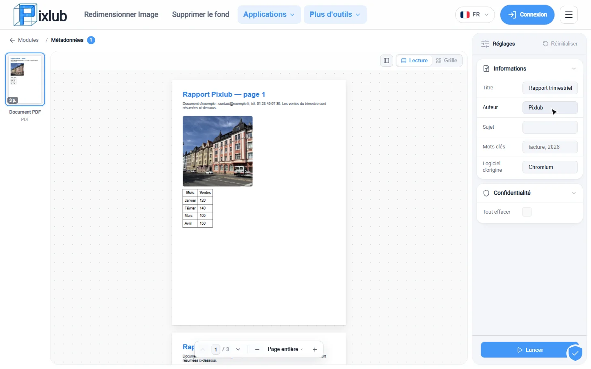

# Métadonnées

Lire et modifier le titre, l'auteur, le sujet et les mots-clés d'un PDF, ou les effacer.

**Catégorie** : Documents · **Identifiant** : `docMetadata`

## Où l'utiliser

- **[Page du module](https://pixlub.com/fr/module/docMetadata)** : Déposez vos fichiers, réglez, téléchargez : le module seul, sans rien d'autre.

## Présentation vidéo

▶ [Voir la vidéo](../../../../assets/modules/docMetadata/demo.fr.mp4) : Modifier titre et auteur, ou tout effacer.

1. `0:00` Importer un PDF
2. `0:03` Modifier titre et auteur
3. `0:12` Ou tout effacer
4. `0:22` Télécharger le résultat

## Utilisation

1. **Importer**

   Déposez un PDF : ses métadonnées actuelles remplissent les champs.

2. **Modifier**

   Titre, auteur, sujet, mots-clés, logiciel d'origine.

3. **Ou tout effacer**

   Avant de partager un fichier, pour n'en rien laisser.

## Réglages

| Réglage | Effet |
| --- | --- |
| **Titre**, **Auteur**, **Sujet**, **Mots-clés**, **Logiciel d'origine** | Informations du document. |
| **Tout effacer** | Retire aussi le producteur, les dates et les métadonnées XMP. |

## Astuces

- Le titre s'affiche dans l'onglet du navigateur à l'ouverture du PDF.
