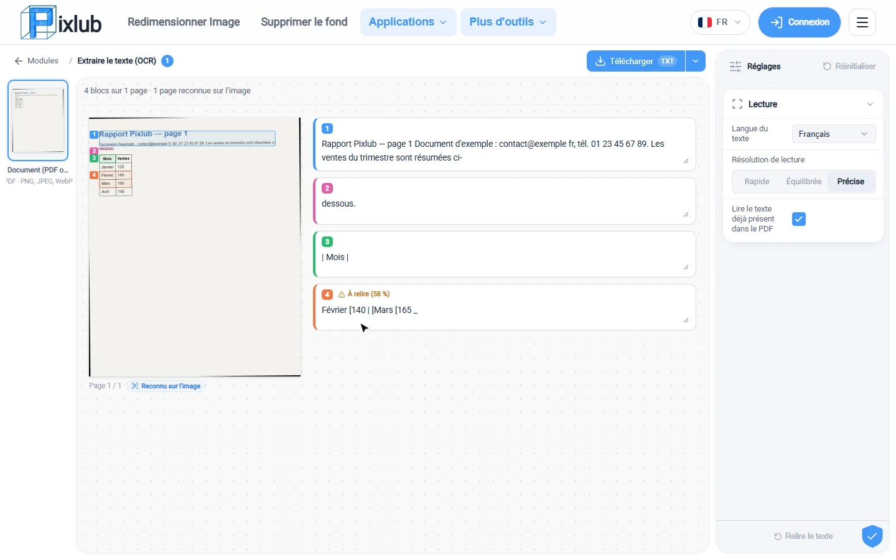

# Extraire le texte (OCR)

Lire le texte d'un PDF, d'un scan ou d'une photo de document.

**Catégorie** : Documents · **Identifiant** : `docOcrText`

## Où l'utiliser

- **[Page du module](https://pixlub.com/fr/module/docOcrText)** : Déposez vos fichiers, réglez, téléchargez : le module seul, sans rien d'autre.

## Présentation vidéo

▶ [Voir la vidéo](../../../../assets/modules/docOcrText/demo.fr.mp4) : Scan importé, blocs à relire, langue et résolution.

1. `0:00` Importer un scan
2. `0:06` Relire les blocs
3. `0:08` Langue et résolution
4. `0:14` Télécharger le résultat

## Utilisation

1. **Importer**

   Un PDF, un scan ou une photo (PNG, JPEG, WebP).

2. **Relire**

   Le texte s'affiche bloc par bloc ; les blocs douteux sont signalés « À relire » et se corrigent sur place.

3. **Télécharger**

   En texte brut ou en PDF consultable.

## Réglages

| Réglage | Effet |
| --- | --- |
| **Langue du texte** | Améliore la reconnaissance des accents et des mots. |
| **Résolution de lecture** | Rapide, équilibrée ou précise (300 ppp). |
| **Lire le texte déjà présent dans le PDF** | Une page qui a déjà son texte est lue telle quelle, sans erreur. |

## Astuces

- La reconnaissance tourne dans votre navigateur : le document ne part pas.
