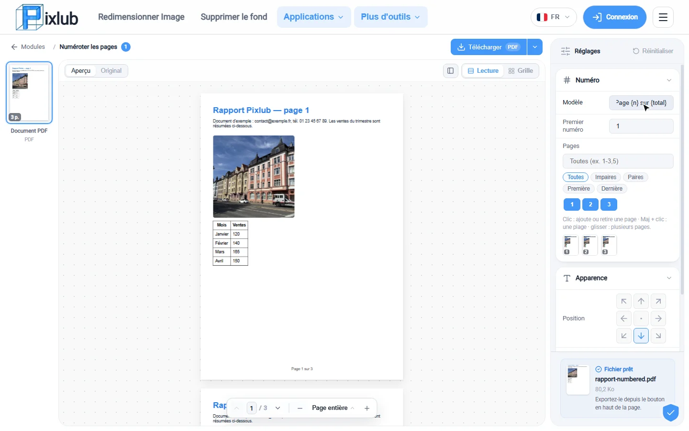

# Numéroter les pages

Ajouter un numéro sur chaque page, à la place et au format choisis.

**Catégorie** : Documents · **Identifiant** : `docPageNumbers`

## Où l'utiliser

- **[Page du module](https://pixlub.com/fr/module/docPageNumbers)** : Déposez vos fichiers, réglez, téléchargez : le module seul, sans rien d'autre.

## Présentation vidéo

▶ [Voir la vidéo](../../../../assets/modules/docPageNumbers/demo.fr.mp4) : Modèle du numéro, position et taille.

1. `0:00` Importer un PDF
2. `0:03` Modèle du numéro
3. `0:13` Position et taille
4. `0:21` Télécharger le résultat

## Utilisation

1. **Importer**

   Déposez un PDF.

2. **Écrire le modèle**

   `{n}` est le numéro, `{total}` le nombre de pages : `Page {n} sur {total}`.

3. **Placer**

   Position, taille, marge et couleur.

## Réglages

| Réglage | Effet |
| --- | --- |
| **Modèle** | Texte avec `{n}` et `{total}`. |
| **Premier numéro** | Numéro de la première page numérotée. |
| **Pages** | Pages qui reçoivent un numéro. |
| **Position** / **Taille** / **Marge** / **Couleur** | Apparence du numéro. |

## Astuces

- Pour ne pas numéroter la couverture, choisissez les pages à partir de 2 et commencez à 2.
