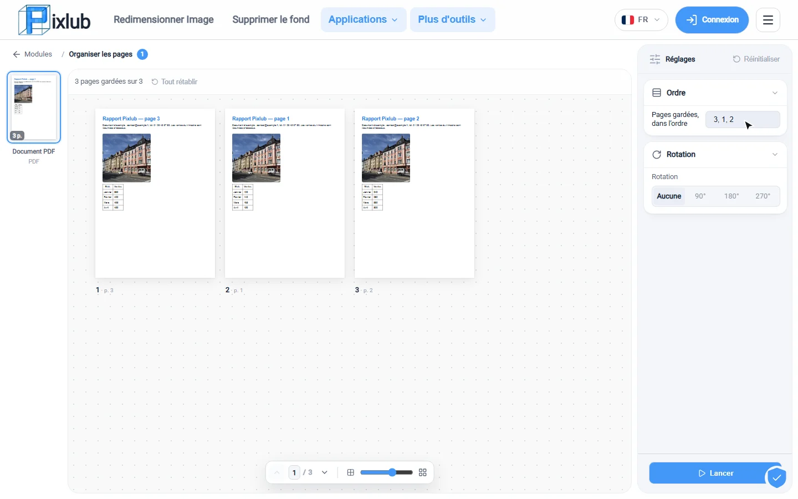

# Organiser les pages

Garder, supprimer, réordonner, dupliquer ou tourner les pages d'un PDF.

**Catégorie** : Documents · **Identifiant** : `docPages`

## Où l'utiliser

- **[Page du module](https://pixlub.com/fr/module/docPages)** : Déposez vos fichiers, réglez, téléchargez : le module seul, sans rien d'autre.

## Présentation vidéo

▶ [Voir la vidéo](../../../../assets/modules/docPages/demo.fr.mp4) : Réordonner, puis tourner des pages.

1. `0:00` Importer un PDF
2. `0:04` Réordonner les pages
3. `0:07` Tourner des pages
4. `0:14` Télécharger le résultat

## Utilisation

1. **Importer**

   Déposez un PDF ; la grille montre ses pages.

2. **Choisir les pages**

   Écrivez les pages gardées, dans l'ordre : `3, 1, 2`. Une page absente est supprimée, une page répétée dupliquée.

3. **Tourner**

   Choisissez l'angle et les pages concernées.

## Réglages

| Réglage | Effet |
| --- | --- |
| **Pages gardées, dans l'ordre** | Liste et plages : `1-3, 5, 2`. |
| **Rotation** | 0°, 90°, 180° ou 270°. |
| **Pages tournées** | Les pages qui reçoivent la rotation. |

## Astuces

- Pour réorganiser à la souris, ouvrez l'[Éditeur PDF](../../../../01-app/fr/04-document.md#editeur-pdf).
