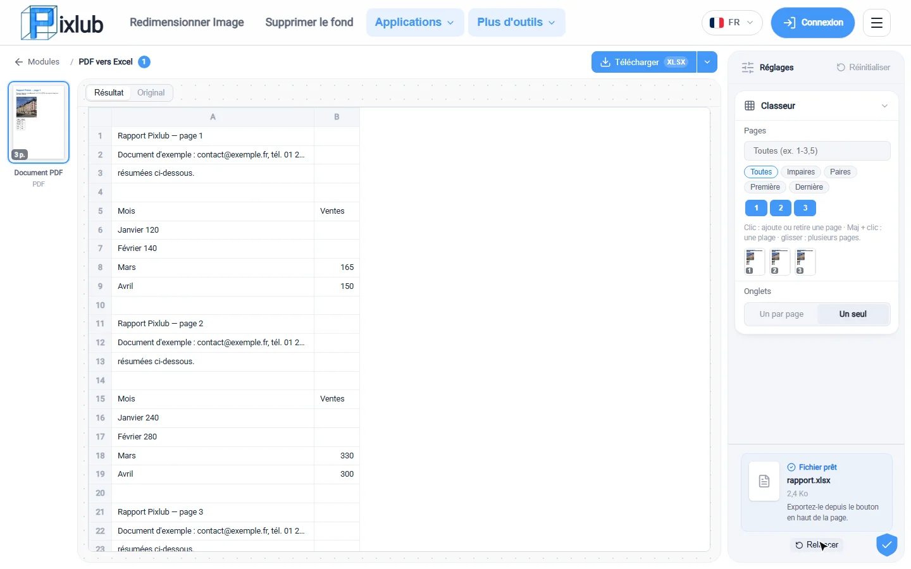

# PDF vers Excel

Ranger le contenu d'un PDF dans un classeur : colonnes et nombres compris.

**Catégorie** : Documents · **Identifiant** : `docPdfToExcel`

## Où l'utiliser

- **[Page du module](https://pixlub.com/fr/module/docPdfToExcel)** : Déposez vos fichiers, réglez, téléchargez : le module seul, sans rien d'autre.

## Présentation vidéo

▶ [Voir la vidéo](../../../../assets/modules/docPdfToExcel/demo.fr.mp4) : Un onglet par page ou un seul, puis le .xlsx.

1. `0:00` Importer un PDF
2. `0:03` Un onglet par page, ou un seul
3. `0:10` Télécharger le résultat

## Utilisation

1. **Importer**

   Déposez un PDF avec des tableaux.

2. **Choisir les onglets**

   Un onglet par page, ou un seul onglet pour tout.

3. **Lancer**

   Les colonnes alignées deviennent des colonnes, les nombres des nombres.

## Réglages

| Réglage | Effet |
| --- | --- |
| **Pages** | Pages reprises. |
| **Onglets** | Un par page ou un seul. |

## Astuces

- Les nombres sont de vrais nombres : les formules fonctionnent tout de suite.
