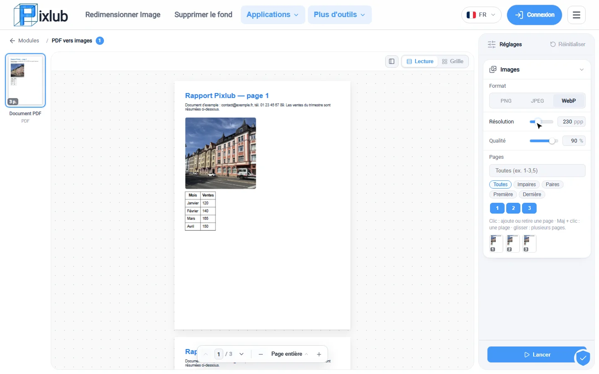

# PDF vers images

Exporter chaque page d'un PDF en PNG, JPEG ou WebP.

**Catégorie** : Documents · **Identifiant** : `docPdfToImages`

## Où l'utiliser

- **[Page du module](https://pixlub.com/fr/module/docPdfToImages)** : Déposez vos fichiers, réglez, téléchargez : le module seul, sans rien d'autre.

## Présentation vidéo

▶ [Voir la vidéo](../../../../assets/modules/docPdfToImages/demo.fr.mp4) : Format et résolution, choix des pages.

1. `0:00` Importer un PDF
2. `0:03` Format et résolution
3. `0:08` Choisir les pages
4. `0:14` Télécharger le résultat

## Utilisation

1. **Importer**

   Déposez un PDF.

2. **Choisir le format**

   PNG, JPEG ou WebP, et la **résolution**.

3. **Lancer**

   Une image par page, dans une archive ZIP.

## Réglages

| Réglage | Effet |
| --- | --- |
| **Format** | PNG, JPEG ou WebP. |
| **Résolution** | 72 à 600 ppp. |
| **Qualité** | JPEG et WebP : 30 à 100 %. |
| **Pages** | Toutes, impaires, paires, première, dernière ou au choix. |

## Astuces

- 150 ppp suffit pour l'écran, 300 ppp pour l'impression.
