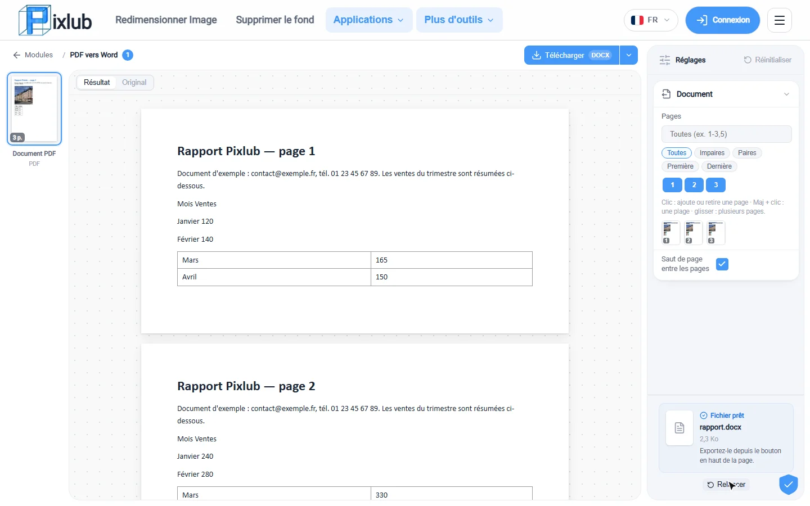

# PDF vers Word

Reprendre les titres, paragraphes et tableaux d'un PDF dans un document Word modifiable.

**Catégorie** : Documents · **Identifiant** : `docPdfToWord`

## Où l'utiliser

- **[Page du module](https://pixlub.com/fr/module/docPdfToWord)** : Déposez vos fichiers, réglez, téléchargez : le module seul, sans rien d'autre.

## Présentation vidéo

▶ [Voir la vidéo](../../../../assets/modules/docPdfToWord/demo.fr.mp4) : Importer, lancer, télécharger le .docx.

1. `0:00` Importer un PDF
2. `0:03` Pages et sauts de page
3. `0:12` Télécharger le résultat

## Utilisation

1. **Importer**

   Déposez un PDF qui contient du texte.

2. **Lancer**

   Titres, paragraphes et tableaux sont repris dans un .docx.

## Réglages

| Réglage | Effet |
| --- | --- |
| **Pages** | Pages reprises. |
| **Saut de page entre les pages** | Garde le découpage en pages du PDF. |

## Astuces

- Un PDF scanné n'a pas de texte : passez d'abord par [Extraire le texte (OCR)](../docOcrText/README.md).
