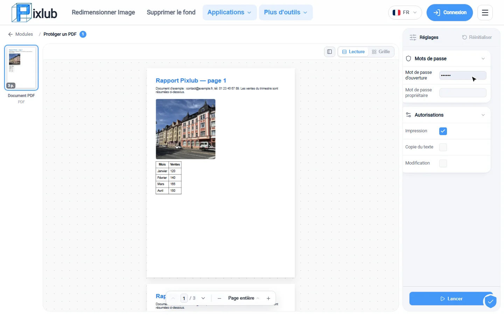

# Protéger un PDF

Chiffrer un PDF par mot de passe et limiter ce qu'on peut en faire.

**Catégorie** : Documents · **Identifiant** : `docProtect`

## Où l'utiliser

- **[Page du module](https://pixlub.com/fr/module/docProtect)** : Déposez vos fichiers, réglez, téléchargez : le module seul, sans rien d'autre.

## Présentation vidéo

▶ [Voir la vidéo](../../../../assets/modules/docProtect/demo.fr.mp4) : Mot de passe d'ouverture, autorisations.

1. `0:00` Importer un PDF
2. `0:03` Mot de passe d’ouverture
3. `0:07` Autorisations
4. `0:13` Télécharger le résultat

## Utilisation

1. **Importer**

   Déposez un PDF.

2. **Choisir les mots de passe**

   **Ouverture** pour lire le fichier, **propriétaire** pour changer les droits.

3. **Régler les autorisations**

   Impression, copie du texte, modification.

## Réglages

| Réglage | Effet |
| --- | --- |
| **Mot de passe d'ouverture** | Demandé à chaque ouverture. |
| **Mot de passe propriétaire** | Protège les autorisations. |
| **Impression** / **Copie du texte** / **Modification** | Ce que le lecteur a le droit de faire. |

## Astuces

- Chiffrement AES-256, fait dans votre navigateur : le fichier ne part pas.
