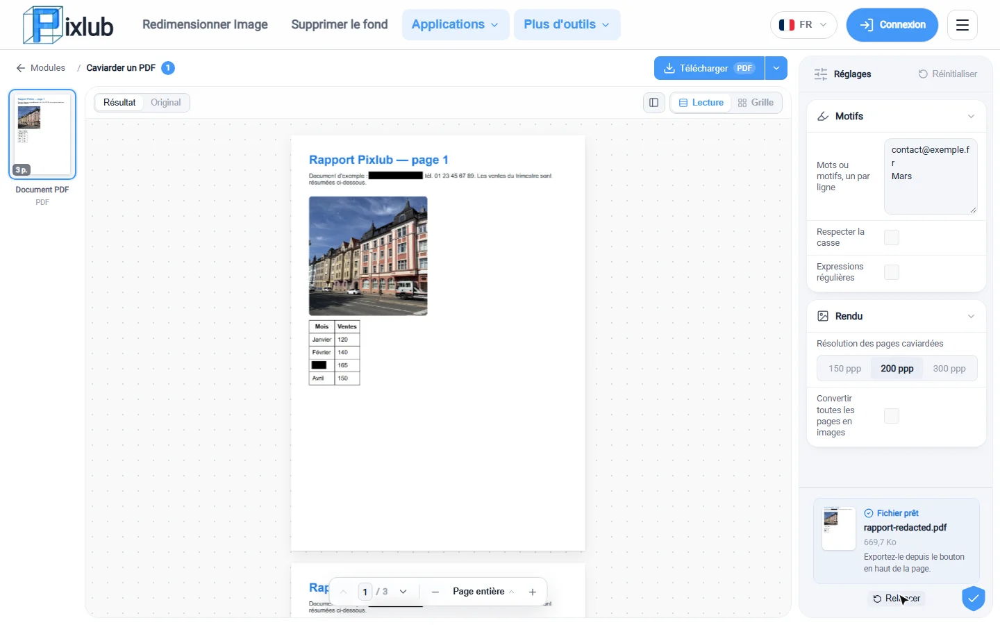

# Caviarder un PDF

Noircir des mots ou des motifs : le texte disparaît vraiment de la page.

**Catégorie** : Documents · **Identifiant** : `docRedact`

## Où l'utiliser

- **[Page du module](https://pixlub.com/fr/module/docRedact)** : Déposez vos fichiers, réglez, téléchargez : le module seul, sans rien d'autre.

## Présentation vidéo

▶ [Voir la vidéo](../../../../assets/modules/docRedact/demo.fr.mp4) : Mots à noircir, résultat, avant / après.

1. `0:00` Importer un PDF
2. `0:03` Mots à noircir
3. `0:12` Avant / après
4. `0:16` Télécharger le résultat

## Utilisation

1. **Importer**

   Déposez un PDF.

2. **Écrire les mots**

   Un mot ou un motif par ligne : adresse, nom, numéro…

3. **Lancer**

   Comparez **Résultat** et **Original** avant de télécharger.

## Réglages

| Réglage | Effet |
| --- | --- |
| **Mots ou motifs** | Un par ligne. |
| **Respecter la casse** / **Expressions régulières** | Pour viser précisément, par exemple un numéro de téléphone. |
| **Résolution des pages caviardées** | 150, 200 ou 300 ppp. |
| **Convertir toutes les pages en images** | Plus sûr quand un texte ne se lit pas ; fichier plus lourd. |

## Astuces

- Les pages caviardées deviennent des images : leur texte ne peut plus être copié.
