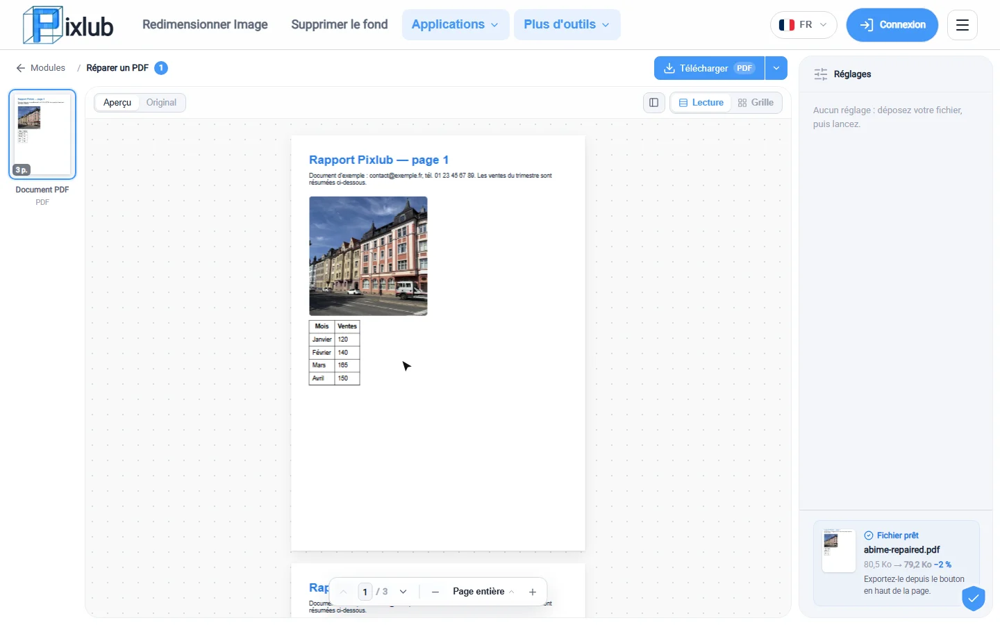

# Réparer un PDF

Reconstruire un PDF endommagé ou qui s'ouvre mal.

**Catégorie** : Documents · **Identifiant** : `docRepair`

## Où l'utiliser

- **[Page du module](https://pixlub.com/fr/module/docRepair)** : Déposez vos fichiers, réglez, téléchargez : le module seul, sans rien d'autre.

## Présentation vidéo

▶ [Voir la vidéo](../../../../assets/modules/docRepair/demo.fr.mp4) : Importer un PDF abîmé, le reconstruire.

1. `0:00` Importer un PDF abîmé
2. `0:03` Reconstruire
3. `0:07` Télécharger le résultat

## Utilisation

1. **Importer**

   Déposez le PDF qui pose problème.

2. **Lancer**

   Table des objets, catalogue et arbre des pages sont reconstruits.

## Astuces

- Un PDF protégé par mot de passe passe d'abord par [Déverrouiller](../docUnlock/README.md).
