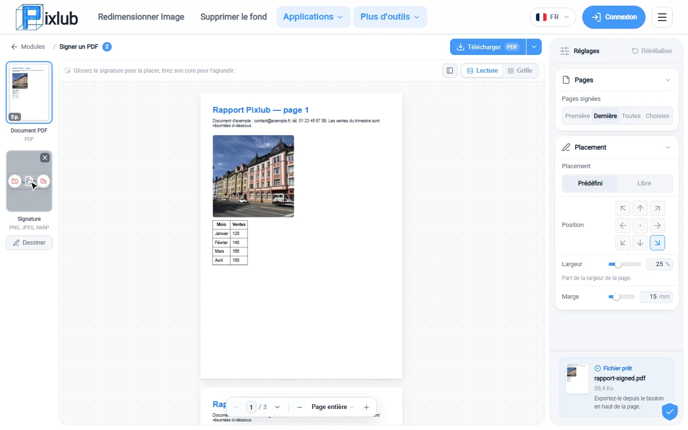

# Signer un PDF

Poser votre signature, dessinée ou importée, sur les pages choisies.

**Catégorie** : Documents · **Identifiant** : `docSign`

## Où l'utiliser

- **[Page du module](https://pixlub.com/fr/module/docSign)** : Déposez vos fichiers, réglez, téléchargez : le module seul, sans rien d'autre.

## Présentation vidéo

▶ [Voir la vidéo](../../../../assets/modules/docSign/demo.fr.mp4) : PDF, signature, pages et position.

1. `0:00` Importer un PDF
2. `0:03` Ajouter la signature
3. `0:07` Pages et position
4. `0:15` Télécharger le résultat

## Utilisation

1. **Importer le PDF**

   Dans la première case.

2. **Ajouter la signature**

   Importez une image, ou **Dessiner** à la souris, au stylet ou au doigt.

3. **Placer**

   Une position prédéfinie, ou **Libre** : glissez la signature sur la page, tirez son coin pour l'agrandir.

## Réglages

| Réglage | Effet |
| --- | --- |
| **Pages signées** | Première, dernière, toutes ou choisies. |
| **Placement** | Prédéfini (position et marge) ou libre. |
| **Largeur** | 5 à 80 % de la largeur de la page. |

## Astuces

- Il s'agit d'une signature visuelle, pas d'une signature électronique certifiée.
