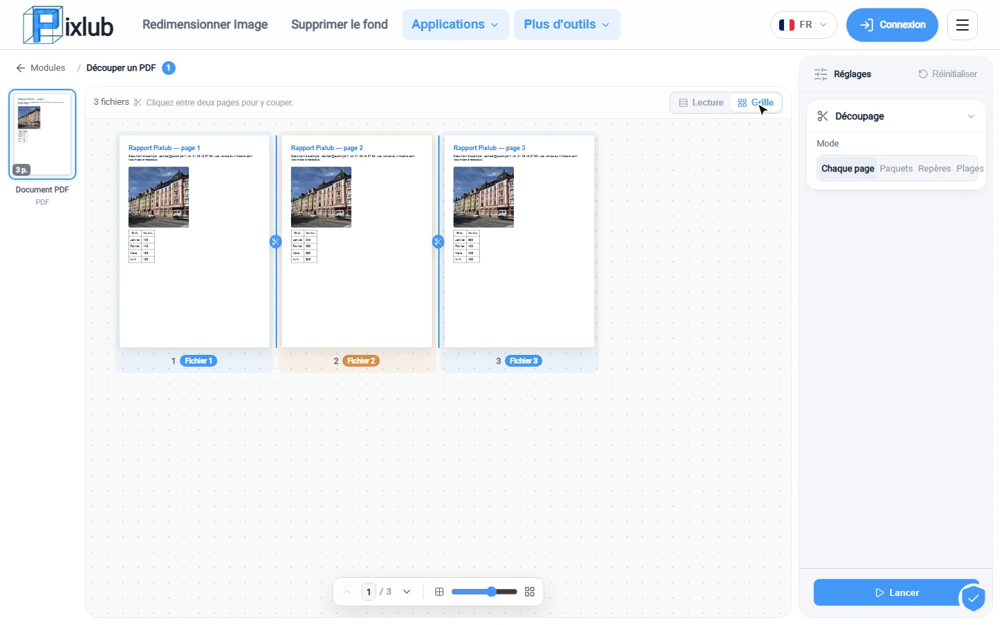

# Découper un PDF

Séparer un PDF en plusieurs fichiers : par page, par paquets, par repères ou par plages.

**Catégorie** : Documents · **Identifiant** : `docSplit`

## Où l'utiliser

- **[Page du module](https://pixlub.com/fr/module/docSplit)** : Déposez vos fichiers, réglez, téléchargez : le module seul, sans rien d'autre.

## Présentation vidéo

▶ [Voir la vidéo](../../../../assets/modules/docSplit/demo.fr.mp4) : Une page par fichier, par paquets, puis par plages.

1. `0:00` Importer un PDF
2. `0:03` Une page par fichier
3. `0:06` Par paquets
4. `0:10` Ou selon des plages
5. `0:19` Télécharger le résultat

## Utilisation

1. **Importer**

   Déposez un PDF : la grille montre les futurs fichiers en couleur.

2. **Choisir le mode**

   **Chaque page**, **Paquets**, **Repères** (cliquez entre deux pages pour couper) ou **Plages**.

3. **Lancer**

   Les fichiers se téléchargent en archive ZIP.

## Réglages

| Réglage | Effet |
| --- | --- |
| **Mode** | Chaque page, paquets, repères ou plages. |
| **Pages par fichier** | Mode Paquets : taille de chaque paquet. |
| **Plages** | Mode Plages : par exemple `1-2, 3`. |

## Astuces

- L'export peut aussi sortir chaque morceau en images.
