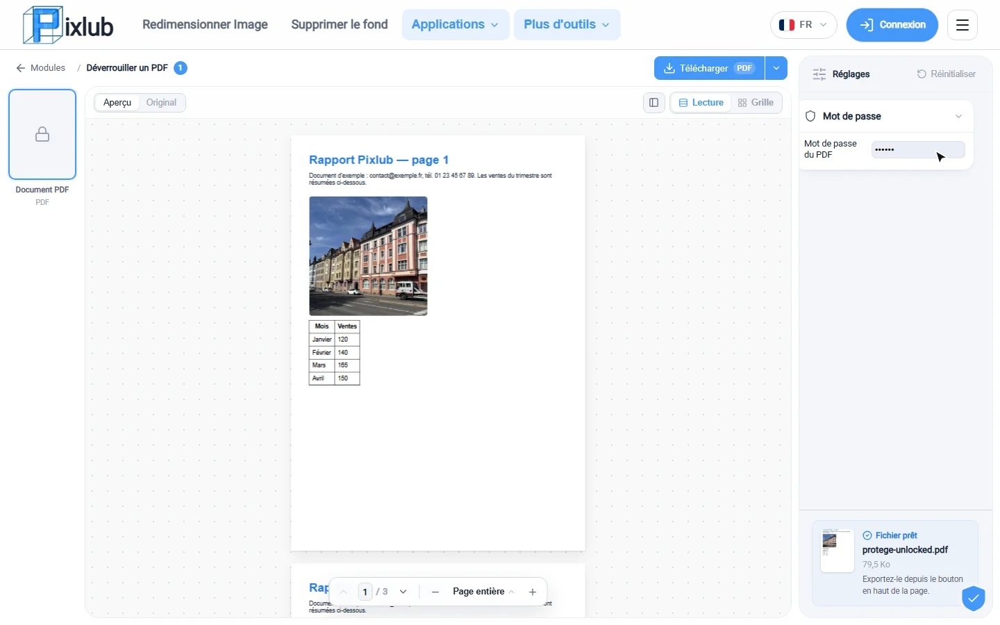

# Déverrouiller un PDF

Retirer le mot de passe et les restrictions d'un PDF dont vous connaissez le mot de passe.

**Catégorie** : Documents · **Identifiant** : `docUnlock`

## Où l'utiliser

- **[Page du module](https://pixlub.com/fr/module/docUnlock)** : Déposez vos fichiers, réglez, téléchargez : le module seul, sans rien d'autre.

## Présentation vidéo

▶ [Voir la vidéo](../../../../assets/modules/docUnlock/demo.fr.mp4) : PDF protégé, mot de passe, fichier libre.

1. `0:00` Importer un PDF protégé
2. `0:03` Saisir son mot de passe
3. `0:10` Télécharger le résultat

## Utilisation

1. **Importer**

   Déposez le PDF protégé.

2. **Saisir le mot de passe**

   Puis **Lancer** : le PDF sort sans mot de passe ni restriction.

## Réglages

| Réglage | Effet |
| --- | --- |
| **Mot de passe du PDF** | Celui qui ouvre le fichier. |

## Astuces

- Ce module ne devine pas un mot de passe oublié.
