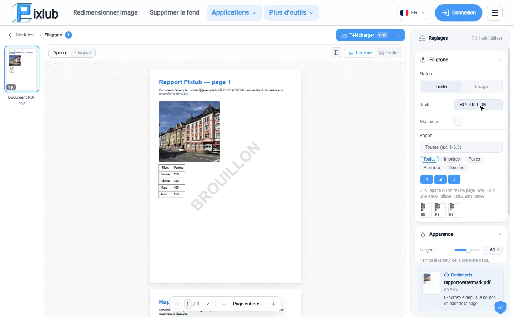

# Filigrane

Poser un texte ou une image translucide sur les pages d'un PDF.

**Catégorie** : Documents · **Identifiant** : `docWatermark`

## Où l'utiliser

- **[Page du module](https://pixlub.com/fr/module/docWatermark)** : Déposez vos fichiers, réglez, téléchargez : le module seul, sans rien d'autre.

## Présentation vidéo

▶ [Voir la vidéo](../../../../assets/modules/docWatermark/demo.fr.mp4) : Texte, mosaïque, opacité et inclinaison.

1. `0:00` Importer un PDF
2. `0:03` Texte du filigrane
3. `0:08` Mosaïque
4. `0:10` Opacité et inclinaison
5. `0:17` Télécharger le résultat

## Utilisation

1. **Importer**

   Déposez un PDF ; pour un logo, ajoutez aussi l'image.

2. **Choisir le filigrane**

   **Texte** (par exemple « CONFIDENTIEL ») ou **Image**, une fois ou en **mosaïque**.

3. **Régler**

   Largeur, opacité, inclinaison et couleur ; l'aperçu se met à jour.

## Réglages

| Réglage | Effet |
| --- | --- |
| **Nature** | Texte ou image. |
| **Mosaïque** | Répète le filigrane sur toute la page. |
| **Pages** | Toutes, impaires, paires, première, dernière ou au choix. |
| **Largeur** / **Opacité** / **Inclinaison** | 5 à 100 %, 5 à 100 %, −90° à 90°. |

## Astuces

- Un PNG à fond transparent donne le meilleur rendu pour un logo.
